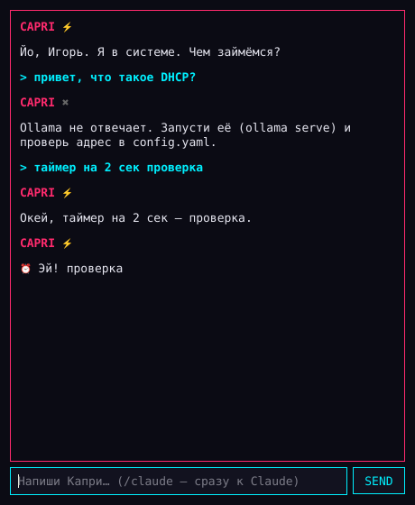

# CAPRI — локальный ИИ-компаньон для рабочего стола

Фан-проект, вдохновлённый Капри из *Cyberpunk: Edgerunners 2*. Живёт на рабочем столе, понимает русский, немецкий, английский (и иврит),
запускает программы, ищет информацию, ставит таймеры — а сложные задачи передаёт **Claude**.

> Неофициальный фан-проект. Не связан с CD PROJEKT RED, Studio Trigger или Netflix.
> Арт из сериала в репозиторий не входит — по умолчанию используется оригинальный аватар.



## Как это работает

```
 запрос ──► быстрые правила ──► действие (мгновенно, без ИИ)
              │ не узнал
              ▼
          локальная модель (Ollama) ──► ответ / инструмент
              │ сложная задача
              ▼
          Claude Code (claude -p, по твоей подписке)
```

| Пример запроса | Кто обрабатывает |
|---|---|
| «открой браузер», «таймер на 10 минут», «загугли настройка VLAN» | правила ⚡ |
| «что такое DHCP?», «найди инфу по DNS» | Ollama ◆ |
| «напиши PowerShell-скрипт бэкапа», «/claude разбери ошибку…» | Claude ✦ |

## Безопасность

- Программы запускаются **только из белого списка** в `config.yaml` — никакого произвольного shell.
- Сайты — только `http/https`.
- Перед запуском программ и сайтов — **окно подтверждения** (`confirm_actions`).
- Claude Code работает в режиме `plan`: только читает и отвечает, файлы не меняет.
- Локальная модель работает на твоём ПК, данные никуда не уходят. Наружу уходит только то, что ты сам отправил Claude.

## Установка (Windows)

1. **Python 3.11+** — https://www.python.org (галочка «Add to PATH»).
2. **Ollama** — https://ollama.com, затем в терминале:
   ```
   ollama pull qwen3:8b
   ```
   **Какую модель выбрать:**

   | Компьютер | Модель | Настройка в `config.yaml` |
   |---|---|---|
   | ПК с видеокартой NVIDIA 8 ГБ+ | `qwen3:8b` | `model: qwen3:8b` |
   | Ноутбук без видеокарты (только процессор) | `qwen3:4b-instruct` | `model: qwen3:4b-instruct`, `think: false` |

   Проверить, на чём работает модель: `ollama ps` → колонка PROCESSOR (`100% GPU` — отлично, `100% CPU` — бери instruct-модель).
3. **Claude Code** (по желанию, для сложных задач):
   ```
   irm https://claude.ai/install.ps1 | iex
   claude      # один раз войти в аккаунт
   ```
4. Клонировать и запустить:
   ```
   git clone https://github.com/<твой-ник>/capri.git
   cd capri
   run_capri.bat
   ```
   При первом запуске создастся `.venv` и `config.yaml`.

Запуск вручную: `python -m capri`. Тесты: `pip install pytest && pytest`.

## Управление

- **ЛКМ по аватару** — открыть/закрыть чат, **перетаскивание** — переместить, **ПКМ** — меню.
- `/claude <задача>` — сразу отправить задачу Claude.
- Статусы: `ONLINE` · `THINKING` (локальная модель) · `CLAUDE` · `TALKING` · `ERROR`.

## Свой аватар и анимация

Положи файлы в `assets/custom/` (папка в git не попадает) и укажи путь в `config.yaml` → `avatar.custom_image`:

- `assets/custom/me.png` — одна картинка
- `assets/custom/me.gif` — анимированный GIF
- `assets/custom/frames/` — папка с кадрами `001.png`, `002.png`, … (скорость — `avatar.fps`)

## Языки

Быстрые команды понимают русский, немецкий и английский («открой браузер», «öffne Rechner», «set a timer for 5 min»).
Всё остальное понимает модель `qwen3:8b` — она отвечает на языке вопроса, включая иврит.

## Структура

```
capri/
  agent.py          роутер: правила → Ollama → Claude
  actions.py        белый список действий
  persona.py        характер
  llm/ollama_client.py, llm/claude_code.py
  ui/avatar.py, ui/chat.py
  app.py            сборка приложения
tests/              pytest
```

## Roadmap

- [x] Аватар, чат, локальные команды, Ollama, Claude Code
- [ ] Голос: faster-whisper (распознавание) + Piper (русская озвучка)
- [ ] Поиск в интернете с кратким пересказом прямо в чате
- [ ] Напоминания по времени, заметки с поиском
- [ ] Автозапуск с Windows, сборка в .exe

## Лицензия

MIT — см. [LICENSE](LICENSE).
